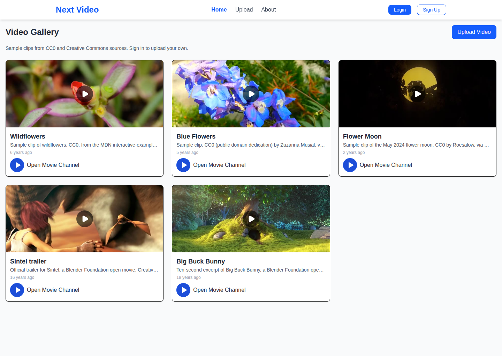
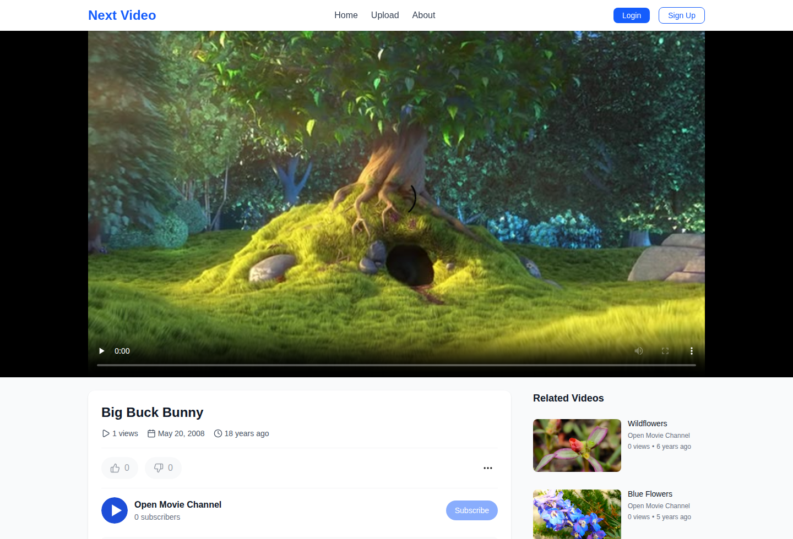
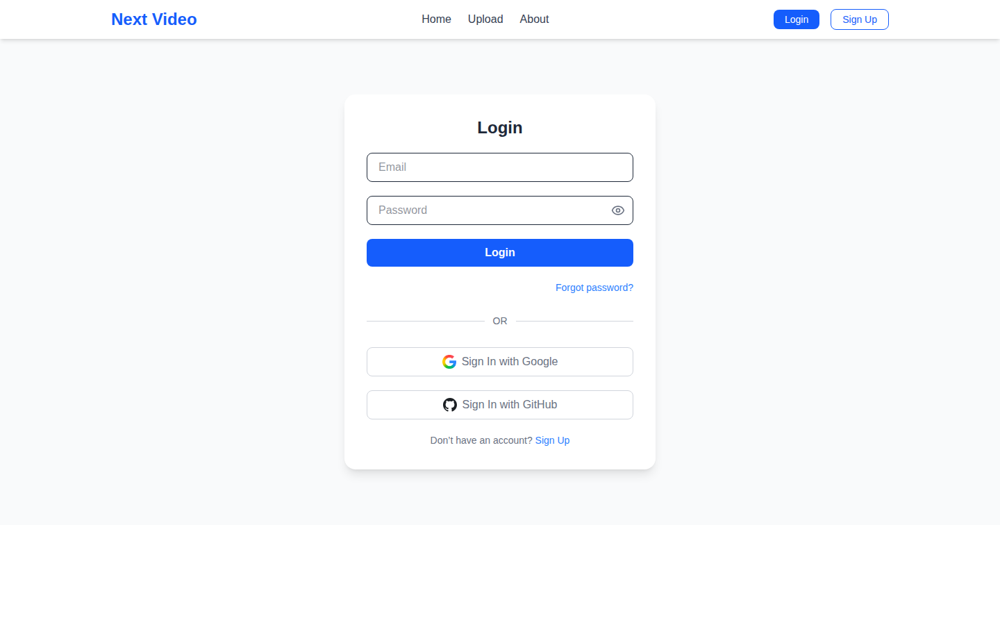

# Next Video

Next Video is a small video-sharing app: a public gallery, a watch page, channels, and member uploads. Signed-out visitors can browse and play clips. Signed-in members can upload a video to their own channel.

Live app: [https://next-video-rouge.vercel.app](https://next-video-rouge.vercel.app)

## Features

- Video gallery and watch page, with likes, views, and related clips
- Email/password accounts, plus Google and GitHub when those providers are configured
- Protected upload page and video APIs
- Channel pages and subscribe
- Password reset by email when mail credentials are set
- Freely licensed sample clips when the database has no videos yet

## Stack

Next.js 15 (App Router), React 19, TypeScript, Tailwind CSS 4, NextAuth, MongoDB with Mongoose, ImageKit for uploaded media, Nodemailer for password reset.

## Architecture

The App Router UI and route handlers read and write MongoDB through Mongoose. NextAuth sessions gate uploads and edits, ImageKit stores files members upload, and an empty `videos` collection falls back to a built-in catalog of CC0 and Creative Commons clips.

## Screenshots







## Setup

Requirements: Node.js 18 or newer, and a MongoDB database for accounts and uploads. The sample gallery works without MongoDB. Uploading a file also needs an [ImageKit](https://imagekit.io) account (free tier is enough; this project does not add a paid service).

```bash
git clone https://github.com/hassan2314/next-video.git
cd next-video
npm install
cp .env.example .env.local
# Fill in placeholders in .env.local. Never commit that file.
npm run dev
```

Open [http://localhost:3000](http://localhost:3000).

### Sample clips and the demo account

If `MONGODB_URI` is missing, or the database has no videos, `GET /api/video` returns the built-in catalog. No API key is required for that path. The clips stay on their original hosts (MDN, Wikimedia Commons, Blender Foundation, and a short CC BY excerpt of Big Buck Bunny). Posters in `public/demo/` are single frames from those same clips.

To store the same clips in MongoDB and create a demo login:

```bash
npm run seed
```

The script reads `MONGODB_URI` from the environment, `.env.local`, or `.env`. It only replaces videos owned by the demo account.

| | |
| --- | --- |
| Email | `demo@nextvideo.example` |
| Password | `demopassword` |

Those credentials are fake on purpose. Do not reuse them anywhere else.

Re-running the seed resets that account’s password and replaces its videos.

### Sample clip licenses

| Clip | License |
| --- | --- |
| Wildflowers | CC0, MDN `interactive-examples` (`media/cc0-videos/flower.mp4`) |
| Blue Flowers | CC0, Zuzanna Musial, Wikimedia Commons |
| Flower Moon | CC0, Roesalow, Wikimedia Commons |
| Sintel trailer | CC BY 3.0, Blender Foundation, [sintel.org](https://durian.blender.org/) |
| Big Buck Bunny (10 seconds) | CC BY 3.0, Blender Foundation, [peach.blender.org](https://peach.blender.org/) |

## Environment variables

Copy `.env.example`. Put real values only in `.env.local` or in the Vercel project. Do not commit secrets.

| Name | Required | Purpose |
| --- | --- | --- |
| `MONGODB_URI` | For accounts, uploads, and `npm run seed` | MongoDB connection string. The app uses the database named `test`. |
| `NEXTAUTH_URL` | For sign-in | Site URL, e.g. `http://localhost:3000` or `https://next-video-rouge.vercel.app` |
| `NEXTAUTH_SECRET` | For sign-in | Long random string (`openssl rand -base64 32`) |
| `GOOGLE_ID`, `GOOGLE_SECRET` | No | Google sign-in. Omit both to skip that provider. |
| `GITHUB_ID`, `GITHUB_SECRET` | No | GitHub sign-in. Omit both to skip that provider. |
| `NEXT_PUBLIC_PUBLIC_KEY` | For file uploads | ImageKit public key |
| `IMAGEKIT_PRIVATE_KEY` | For file uploads | ImageKit private key |
| `NEXT_PUBLIC_URL_ENDPOINT` | For file uploads | ImageKit URL endpoint |
| `EMAIL_USER`, `EMAIL_PASS` | No | Mail account used to send password-reset links |
| `NEXT_PUBLIC_APP_URL` | No | Canonical URL for Open Graph tags. Defaults to the live Vercel URL. |

The sample gallery does not need a new variable. Sign-up, sign-in, and the demo seed use the variables above, which this Vercel project already has. Nothing new has to be added in Vercel for the gallery or for auth.

`NEXTAUTH_URL` on the Vercel project should be `https://next-video-rouge.vercel.app`. Set `NEXT_PUBLIC_APP_URL` only if that public URL changes.

To create the demo account in the database the live app uses, pull the existing env (this does not add variables) and run the seed from a trusted machine:

```bash
vercel env pull .env.local
npm run seed
```

`.env.local` is gitignored. Merging to `main` redeploys [https://next-video-rouge.vercel.app](https://next-video-rouge.vercel.app). This repo does not use a second Vercel project.

## Scripts

| Command | What it does |
| --- | --- |
| `npm run dev` | Next.js dev server |
| `npm run build` | Production build |
| `npm run start` | Serve the production build |
| `npm run lint` | ESLint |
| `npm run seed` | Create the demo account and sample videos |

## Project layout

```
src/app/            App Router pages and route handlers
src/components/     Navbar, upload widgets, auth provider
src/lib/            Database, NextAuth, sample catalog
src/models/         User and Video
scripts/seed-demo.ts
public/demo/        Posters and the sample channel avatar
```

Public pages: `/`, `/login`, `/register`, `/videos/[id]`, `/channel/[id]`, `/about`, `/forgot-password`, `/reset-password`.

Signed-in pages: `/upload`, and editing or deleting a video you own.
